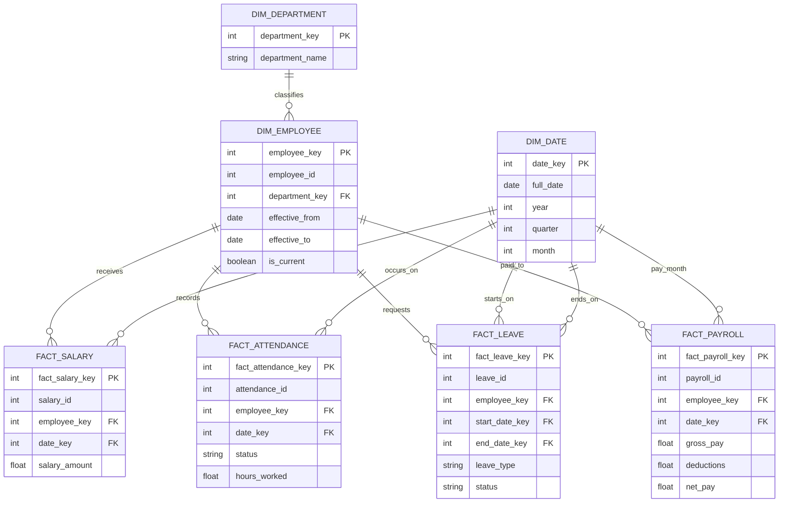

# PulseIQ Star Schema — Day 2

## Join map and fact grain

- `fact_salary`: one row per `salary_id`; joins to employee via `employee_key` and date via `date_key`.
- `fact_attendance`: one row per `attendance_id`; joins to employee via `employee_key` and date via `date_key`.
- `fact_leave`: one row per `leave_id`; joins to employee via `employee_key`; dates via `start_date_key` and `end_date_key`.
- `fact_payroll`: one row per `payroll_id`; joins to employee via `employee_key` and date via `date_key`.
- `dim_employee` joins to `dim_department` via `department_key`.

## Surrogate key and history

`employee_id` is the source/business ID. `employee_key` is a warehouse surrogate key for one version of an employee. Under SCD Type 2, the same `employee_id` can have multiple `employee_key` values with different effective dates.

If a person moves from Sales to Support on July 1, June facts map to the Sales version and July facts map to the Support version. Effective dates are inclusive and must not overlap.

`data/employee_history.csv` is a header-only template. Populate it only with verified history. If it remains empty, the script makes one open-ended version per employee from Task 1's clean table; past department changes cannot be inferred.
